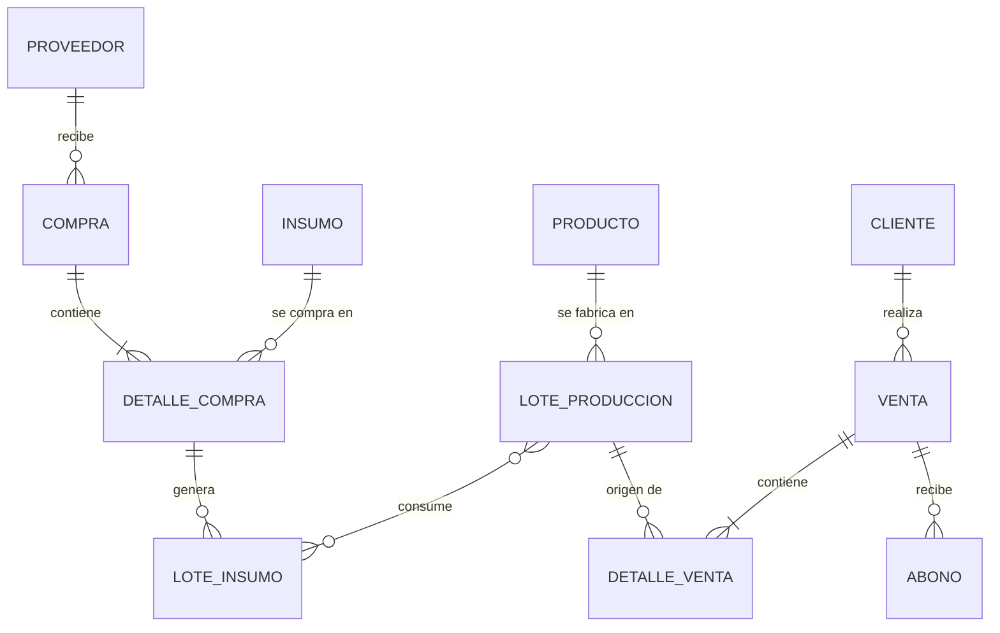

**Python · FastAPI · PostgreSQL · React**

Ingeniero en Sistemas · Quetzaltenango, Guatemala 🇬🇹

 

 

## 👨‍💻 Sobre mí

Construyo **APIs REST con Python y FastAPI**, diseño bases de datos relacionales y desarrollo interfaces con **React y Next.js**. He trabajado en el backend de un sistema de gestión municipal con datos geoespaciales y en proyectos freelance, del backend al frontend.

| | |
|---|---|
| 🎯 **Busco** | Posición junior de backend o full stack |
| 🔨 **Trabajando en** | Base de datos de un sistema de control de inventario |
| 🎓 **Formación** | Ingeniería en Sistemas, Universidad Mesoamericana (pensum cerrado) |
| 🌐 **Idiomas** | Español nativo · Inglés A2 (en mejora) |

 

## 🛠️ Stack

| | |
|---|---|
| **Backend** | Python, FastAPI, SQLAlchemy, Node.js, APIs REST, JWT |
| **Frontend** | React, Next.js, Astro, TypeScript, Tailwind CSS, Vite |
| **Datos** | PostgreSQL, MySQL, SQL Server, PostGIS, modelado y normalización |
| **Otros** | Git/GitHub, Docker, Postman, Linux, Strapi (CMS), Stripe (pagos) |

 

## 🚀 Proyectos

### 📦 Sistema de control de inventario · *en desarrollo*

Base de datos para una empresa que fabrica y distribuye productos de limpieza (caso de negocio simulado): compras, producción por lotes, envasado, ventas en ruta, crédito y cobros.

- **Trazabilidad completa:** de una venta al lote de producción y, desde ahí, a los lotes de insumo.
- **Existencias calculadas, no editadas:** solo cambian por movimientos de inventario.
- **Auditoría y roles:** transacciones que se anulan con motivo (no se borran) y bitácora de cambios.
- **Estado:** diseño conceptual completo; implementación de tablas en curso, empezando por seguridad y catálogos.

<b>Ver diagrama conceptual (simplificado)</b>

<!-- TODO: cuando subas el repo, agrega aquí el enlace: [📂 Ver repositorio](URL) -->

 

### 🗺️ Sistema de gestión municipal · *backend*

Backend de un sistema para la Municipalidad de Palestina de Los Altos, con visualización en mapas de la red de agua potable.

- **17 endpoints REST** usados por 10 usuarios.
- **Datos geoespaciales con PostGIS:** ubicar una tubería pasó de **45 a 10 minutos**.
- Pruebas y documentación técnica para capacitar al equipo.

 

### 🛒 E-commerce Marta · *full stack*

Tienda en línea con catálogo, carrito, checkout y pagos con Stripe. Contenido administrado con Strapi.

 

### 🏨 Hotel Horiani · *propuesta freelance*

Propuesta técnica de un sistema de gestión hotelera (FastAPI, PostgreSQL, React) con sitio web público en Astro, actualmente en construcción.

 

## 💼 Experiencia

**Desarrollador Backend** · Municipalidad de Palestina de Los Altos · 06/2025 – 12/2025

- Desarrollé APIs REST con Python y FastAPI y modelé la base de datos relacional en PostgreSQL.
- Procesé datos geoespaciales con PostGIS para visualizar la red de agua potable en mapas.
- Realicé pruebas y documenté el sistema para capacitar al equipo.

**Desarrollador Full Stack (freelance)** · E-commerce Marta · 06/2024 – 12/2024

- Construí el frontend con React, TypeScript y Next.js; integré Stripe y Strapi.

 

## 📚 Formación

- **Ingeniería en Sistemas**, Universidad Mesoamericana · 2021 – 2025 · pensum cerrado
- **Cursos:** React y Servicios web con Python y FastAPI (Código Facilito) · Bases de datos (TodoCode)

 

<!--
OPCIONAL: estadísticas de GitHub. Actívalas solo cuando tu actividad pública sea sólida
y el servicio responda bien. Quita las marcas de comentario para usarlas.

  
  

-->

